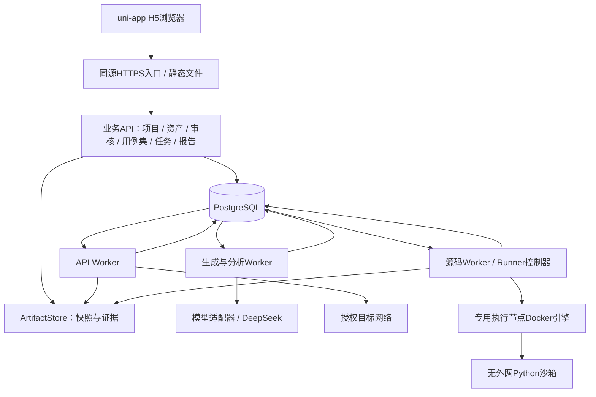
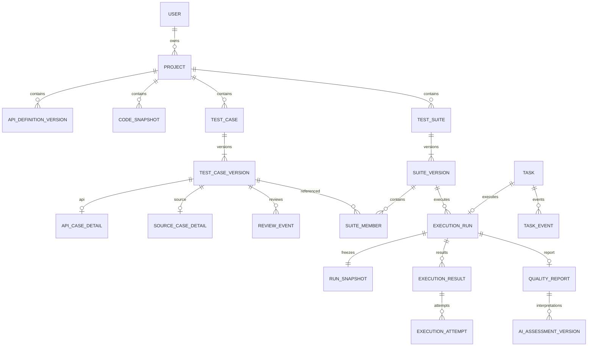
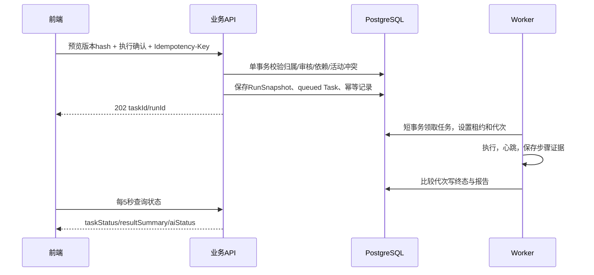

# 智测平台架构设计 V0.1

日期：2026-10-21；状态：设计评审稿。功能以《需求文档V1.3》为准，前后端及任务调度技术由用户确认。本文不代表正式产品已经实现。

## 1 技术基线

| 部分 | 方案 | 状态 |
|---|---|---|
| 前端 | uni-app＋Vue3，H5桌面工作台 | 已确认 |
| 后端 | Python＋FastAPI，模块化单体 | 已确认 |
| 数据库 | PostgreSQL | 已确认 |
| 长任务 | 独立Worker；首版数据库任务表调度 | 已确认 |
| ORM/迁移 | SQLAlchemy＋Alembic | 实现建议 |
| 文件 | ArtifactStore接口＋单机专用目录，预留对象存储适配 | 建议待确认 |
| 部署 | 静态H5＋业务API＋独立Worker＋PostgreSQL；Runner独立权限边界 | 具体机器规格待确认 |

Python可复用已验证的OpenAPI、AST、pytest、coverage与模型适配能力。可行性验证中的SQLite只用于实验，不自动成为正式数据库。

## 2 系统结构



业务API负责鉴权、领域校验和事务，不运行用户源码。API Worker能访问批准目标，Python沙箱默认无外网，不能共用网络开放策略。受信Runner控制器可以管理Docker；被测容器不能访问Docker socket、平台数据库、模型密钥或宿主机敏感目录。

浏览器只提交任务ID和领域参数，不能自选任意镜像、命令、挂载或Docker参数。生产建议将执行节点与业务节点分开；同机开发不等于完成生产级不可信租户隔离。参考[Docker引擎接口保护](https://docs.docker.com/engine/security/protect-access/)。

## 3 前端组织

```text
src/
  pages/                    # 概览、资产、审核、用例集、任务、报告、配置
  components/               # 工作台框架、状态标签、执行确认
  features/api-testing/     # OpenAPI、请求、断言、提取与依赖
  features/source-testing/  # 快照、目标树、pytest编辑
  stores/                   # 会话、项目、编辑状态
  services/                 # uni.request、错误转换、任务轮询
  contracts/                # 后端OpenAPI生成的类型
  adapters/                 # H5代码编辑器、端差异
```

正式开发建议TypeScript。当前原型使用JavaScript单页便于评审，不能直接照搬为一个巨型生产组件。Vue3/Vite CLI与HBuilderX工程依据[DCloud官方说明](https://uniapp.dcloud.net.cn/quickstart-cli.html)。

- 桌面评审建议1440×900，另检查1024px和窄屏；最低浏览器版本待前端负责人确定。
- 页面固定项目上下文，URL引用资源ID，服务端逐资源校验归属。管理员不默认读他人项目。
- 同项目可以有两种测试资产，同一用例集和执行批次只能是一种类型。
- 每5秒查询任务；后台暂停、返回立即刷新、终态停止。请求断开显示最后更新时间，不把失联当任务失败。
- 不把模型或目标凭证放在前端构建变量、日志或本地存储。API请求由服务端发起。
- 代码编辑等H5专属能力放适配层；小程序后置并单独验收，不承诺桌面编辑器直接跨端复用。

## 4 领域模块

| 模块 | 职责与边界 |
|---|---|
| 身份/项目 | 受控账号、owner鉴权、归档、软删除；活动运行时拒绝删除 |
| 资产 | API预览/差异/版本；ZIP校验、不可变快照、AST静态目标 |
| 用例/审核 | 可执行内容改变产生新版本；空断言、未确认、停用或待复核禁止执行 |
| 用例集 | 同类型版本成员、排序和依赖；拒绝环、缺前置和变量冲突 |
| 任务 | 幂等、冻结、领取、心跳、取消、终态、失联恢复 |
| 模型 | 脱敏、结构校验、预算、适配与调用记录；输入文档不获得工具权限 |
| API执行 | 授权网络、变量、严格断言、有限重试、逐尝试证据 |
| 源码执行 | 固定镜像、资源限制、无外网、pytest与行覆盖率 |
| 报告 | 数据事实、AI异步分析、人工版本；AI失败不丢数据报告 |
| 平台 | 管理配置验证启用、审计、通知、限额与保留 |

业务模块保持单体，Worker独立进程。持久长任务不依赖请求进程的内存后台回调。参考[FastAPI后台任务说明](https://fastapi.tiangolo.com/tutorial/background-tasks/)。

## 5 数据模型与约束



ER图为主要关系，不是最终DDL。还需补环境/秘密引用、API定义和源码快照的外键。生成、导入分析和AI分析任务不要求关联执行批次，更不能要求所有API任务上传源码。

| 对象 | 核心字段或约束 |
|---|---|
| Project | owner_id、archived_at、deleted_at；逐资源鉴权 |
| ApiDefinitionVersion | logical_api_id、version、method、path、hash、import_batch_id；唯一(接口ID,版本) |
| CodeSnapshot | project_id、sha256、artifact_id、template_id、兼容结论 |
| TestCaseVersion | case_id、version、kind、status、disabled、needs_review、hash；唯一(用例ID,版本) |
| API/Source详情 | 对应类型一对一详情；不能同时存在两个子类型 |
| ReviewEvent | 精确用例版本、decision、reviewer_id、note、at |
| SuiteVersion/Member | 同项目同类型的用例版本、order、depends_on；多对多可复用 |
| ExecutionRun | task_id、suite_id、suite_version_id、kind；同suite最多一个活动运行 |
| RunSnapshot | 固定用例、输入、环境/秘密引用版本、镜像digest、策略和限额，不可变 |
| Result/Attempt | 参数化项标识、result、attempt_no、阶段时间、脱敏事实和artifact_id |
| Task | queue、kind、status、lease_owner、lease_until、fencing_token、取消时间、错误码 |
| IdempotencyRecord | owner/project/operation/key范围唯一；request_hash、resource_id、expires_at |
| Artifact | 相对存储键、sha256、长度、类型、状态、expires_at；过期保留元数据 |
| Report/AI版本 | run_id唯一数据报告；AI状态独立，人工修正另建版本 |
| Environment/Secret | 配置版本与秘密引用；加密主密钥独立，快照不含凭证明文 |
| Audit/ModelCall/Notification | 操作者、关联ID、时间、用量、脱敏原因、通知状态 |

关键关系用外键，结构化请求/断言及冻结参数可用JSONB。同suite活动运行建议数据库部分唯一索引覆盖queued/running/cancelling。内容版本与审核事件绑定，不能审核旧版本却执行新内容。

## 6 提交、调度与恢复



首版数据库任务表降低队列与业务双写成本。领取短事务使用`FOR UPDATE SKIP LOCKED`，不持锁等待模型或容器；依据[PostgreSQL SELECT文档](https://www.postgresql.org/docs/current/sql-select.html)。

- 建议领取轮询1秒、心跳5秒、失联30秒，待恢复测试实测，不混同前端查询频率。
- 使用数据库时间续租；新领取递增fencing token，旧Worker失租停止派发，旧代次提交被拒。
- 租约不能撤回已发HTTP请求。写步骤先落dispatched再发送；中断后无确定响应标执行错误/未知，不自动重放。不承诺副作用恰好一次。
- 读取重试按配置，断言失败不重试；逐次尝试保留。连续5次连接失败触发环境策略中止，HTTP业务错误不误计。
- Python失联先核对并回收旧任务标签容器，未确认停止前不启动替代任务；源码并发1。
- 同键同参数返回原任务，同键不同参数409；幂等键保留24小时。同suite活动运行冲突409。
- 模型调用前预留预算，每接口/目标最多2次调用，含首次和最多1次修正或重试。
- 未来引入消息服务时使用outbox与消费去重，数据库仍是状态事实来源。

## 7 状态与报告

| 维度 | 状态 |
|---|---|
| 审核 | draft→pendingReview→confirmed/rejected；可执行内容变化创建新版本 |
| 执行任务 | queued→running→succeeded/failed/aborted；queued/running可进入cancelling→cancelled |
| 测试结果 | passed/assertionFailed/executionError/skipped/cancelled |
| AI分析 | pending/running/succeeded/failed |

succeeded表示流程正常结束，可包含断言失败；failed表示平台故障，aborted表示策略中止。取消与完成通过数据库条件更新竞争终态，已结束状态不可相互覆盖。

需求目标为终态后30秒内可查看数据报告，AI另排队。参数化展开结果与逻辑资产分别计数。断言通过率=passed/(passed+assertionFailed)，分母零显示无可判定结果；未执行不能算通过。API接口执行覆盖率与Python行覆盖率分别呈现。证据过期保留统计，AI失败不影响事实。

## 8 接口草案

前缀`/api/v1`，异步202带taskId，错误含code/message/details/requestId。以下用于拆分评审，需补请求响应样例后冻结。

| 方法与路径 | 责任 |
|---|---|
| POST /sessions；DELETE /sessions/current | 登录/退出；建议同源HttpOnly Cookie，写请求校验CSRF |
| GET/POST /projects；GET /projects/{p} | 本人项目与创建 |
| POST /projects/{p}/archive | 归档只读，已有任务继续 |
| POST /projects/{p}/api-imports | 文件/授权URL→预览任务 |
| GET /projects/{p}/api-imports/{id} | 兼容、差异、输入hash |
| POST /projects/{p}/api-imports/{id}/confirm | 确认预览；输入变化或过期409 |
| POST /projects/{p}/source-imports | 有界ZIP→快照与分析任务 |
| POST /projects/{p}/generation-tasks | 测试类型、目标版本、数量→taskId |
| GET /projects/{p}/cases | 类型、审核、检索、游标分页 |
| POST /projects/{p}/cases/{c}/versions | baseVersion与内容→新版本，编辑冲突409 |
| POST /projects/{p}/cases/{c}/versions/{v}/reviews | 审核决定、意见、contentHash |
| POST /projects/{p}/suites/{s}/versions | 成员版本、顺序和依赖 |
| POST /projects/{p}/execution-previews | 返回冻结候选、写操作摘要和短时有效预览 |
| POST /projects/{p}/runs | previewId、hash、写确认；幂等提交 |
| GET /projects/{p}/tasks/{t}；POST .../{t}/cancel | 轮询/取消，返回实际终态或取消中 |
| GET /projects/{p}/runs/{r}/report | 数据报告、证据状态、AI状态 |
| POST /projects/{p}/runs/{r}/assessments | 人工研判新版本 |
| POST /admin/model-configs/{id}/validate；POST .../enable | 草稿验证后启用，审计 |

跨项目资源建议404避免泄露存在性，已知资源操作越权403；过大413、结构422、容量429、冲突409。所有资源路由都重新检查项目归属，不能只隐藏前端按钮。

## 9 文件、凭证与隔离

- 下载及本轮设计输出保存在F盘；当前用户要求不修改E盘。本轮不变更已有Docker数据位置。
- ArtifactStore只接受资源ID，服务端解析真实路径。避免文件名穿越、软链接和秘密混入。
- ZIP有界校验路径、加密、链接、解压量、文件数和目录深度；静态分析不能import用户模块。
- API目标和URL导入检查协议、端口、DNS解析和重定向；受控内网白名单不是开放全部内网。
- 凭证采用具备完整性保护的加密，主密钥与数据库分离。快照只保存秘密引用及版本，模型输入/证据持续脱敏。
- Python沙箱固定镜像digest、非root、无外网、只读根目录、cap-drop、no-new-privileges、受限tmpfs、CPU/内存/进程数；宿主控制器总超时和清理。
- F盘为FAT32，单文件最大4GiB，不适合大虚拟磁盘；本次还出现目录变为全FF普通文件，见恢复记录。在介质稳定性确认前不部署持久数据库或进行大量依赖安装。

## 10 资源与开工事项

| 项目 | 数值 | 状态 |
|---|---|---|
| API接口导入 | 300/次 | 已有需求 |
| API并发/请求超时 | 5/30秒 | 已有需求 |
| 源码并发 | 1 | 已有需求 |
| 沙箱初值 | 1CPU/256MiB/64进程/32MiB tmpfs/90秒 | 已在样例使用，正式容量待测 |
| ZIP初值 | 压缩10MiB/解压50MiB/1000文件/深度10 | 建议待确认 |
| 导入JSON/响应体 | 5MiB/每请求2MiB；超限不能判通过 | 建议待测 |
| 队列容量/API总时长 | 各20项/10分钟 | 建议待测 |
| 模型 | 最多2次/目标；token与金额上限待定 | 次数已有需求，预算待定 |
| 幂等/证据保留 | 24小时/180天 | 已有需求；源码原包和秘密版本保留另定 |

后续顺序：身份项目及数据迁移→人工API闭环→人工pytest隔离闭环→模型和预算→取消恢复幂等→固定样本性能与安全验收。先冻结DDL、字段示例、资源限额、部署负责人、预算和排期。可行性通过不等于产品验收通过。

## 11 依据

- [需求文档V1.3](../referenced-chatgpt-conversation-this-is-an/outputs/需求文档_V1.3.md)
- [核心技术可行性报告](../zhitest-feasibility/技术可行性验证报告.md)
- 本次用户技术决策见[决策记录](./决策记录.md)。
